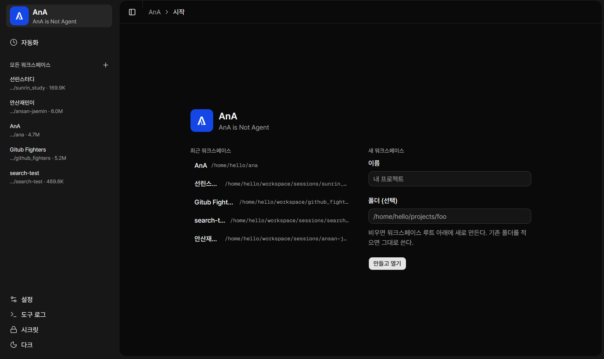
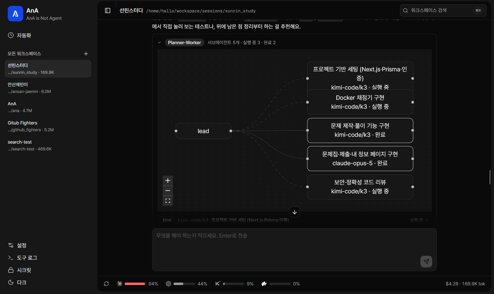

# AnA

**한국어** | [English](README.en.md)

> AnA is Not Agent.

AnA는 에이전트 CLI를 감싸는 오케스트레이터입니다. **Claude Code CLI**
(`claude`)와 **Codex CLI**(`codex`)를 구동하고, 메시지마다 더 잘 맞는 쪽으로
보내며, 전환할 때 대화 맥락을 넘겨주어 넘겨받은 CLI가 처음부터 다시 시작하지
않고 작업을 이어가게 합니다.

관리 단위는 **워크스페이스**입니다. 폴더 하나, 그 안에서 일하는 리드 에이전트
하나, 그리고 그 에이전트가 이어가는 대화 하나로 이루어집니다.

- **스택**: Python (FastAPI + LangGraph + Postgres/pgvector) · TypeScript
  (Next.js, 자체 UI) · Docker Compose
- **설계 문서**: `docs/plans/`

<p align="center">
  
  
</p>

## 실행

```bash
cp .env.example .env     # 필요한 값을 채웁니다 (아래 참고)
docker compose up
```

- 웹 UI: http://localhost:3005
- API: http://localhost:8100 — `GET /healthz`, `GET/POST /workspaces`,
  `GET /threads/{id}/turns` (새로고침 시 대화 기록), `GET /audit`
  (거버넌스 로그), `GET /usage` (한도 윈도), `GET /secrets`,
  `POST /gate/tool-call` (CLI의 훅이 호출), `WS /ws/chat?workspace=<id>`

포트가 흔히 쓰는 3000 / 8000 / 5432가 아니라 3005 / 8100 / 15432인 이유는 이
머신에서 다른 서비스가 이미 그 포트를 쓰고 있기 때문입니다. Compose 네트워크
안에서는 서비스끼리 여전히 3000 / 8000 / 5432로 통신합니다.

채팅 하단의 사용량 줄에는 새로고침 버튼이 있습니다. `POST /usage/sync`는
제공자의 실제 수치를 필요할 때 다시 읽어옵니다. Codex 수치는 자체 롤아웃 로그에서
비용 없이 읽고, Claude는 턴이 스트리밍되는 동안에만 윈도 정보를 내보내므로 버튼이
도구를 쓰지 않는 짧은 프롬프트를 한 번 실행해 수집합니다. 수백 토큰 정도이며 다른
턴과 똑같이 기록됩니다. 어느 한쪽을 갱신하지 못하면 오래된 숫자를 새것처럼 남겨두지
않고, 토스트로 어느 쪽이 왜 실패했는지 알려줍니다.

두 CLI는 서버 컨테이너 안에서 실행되며, Compose가 읽기-쓰기로 마운트한 호스트
설정 `~/.claude`와 `~/.codex`로 인증합니다. 먼저 호스트에서 로그인하세요
(`claude`, `codex login`). 이 마운트는 각 CLI가 `--resume` / `codex exec resume`에
필요한 세션 파일을 저장하는 곳이기도 합니다.

### 로컬 개발 (이미지 빌드 없이)

Postgres는 Compose로, 두 서버는 호스트에서 실행합니다:

```bash
docker compose up -d postgres

set -a && . ./.env && set +a
.venv/bin/python -m uvicorn apps.server.app.main:app --host 0.0.0.0 --port 8100

cd apps/web && NEXT_PUBLIC_WS_PORT=8100 npm run dev -- -p 3005 -H 0.0.0.0
```

`.env.example`의 `DATABASE_URL`은 이미 `127.0.0.1:15432`의 Compose Postgres를
가리킵니다. `docker compose up`으로 실행하면 서버는 자체 값을 받습니다.
`ANA_ALLOWED_ORIGINS`에는 브라우저가 실제로 쓰는 origin이 들어 있어야 합니다.
빠진 항목이 있으면 WebSocket이 코드 1008로 닫히고 UI에는 "disconnected"만
표시됩니다.

### 환경 변수

| 변수                                | 의미                                                                                                                                                                    |
| ----------------------------------- | ----------------------------------------------------------------------------------------------------------------------------------------------------------------------- |
| `CLAUDE_AUTH_MODE`                  | `claude` 에이전트의 시작 인증 모드: `pro`(`~/.claude`의 구독 로그인) 또는 `api`(`TAPIE_API_KEY`). 설정하지 않으면 `api`이므로, TAPIE를 쓰지 않는다면 `pro`로 설정하세요 |
| `CLAUDE_MODEL`, `CLAUDE_EFFORT`     | 선택적 고정값. 비우면 CLI 기본값                                                                                                                                        |
| `CODEX_MODEL`, `CODEX_EFFORT`       | `codex`의 선택적 고정값. 비우면 CLI 기본값                                                                                                                              |
| `KIMI_MODEL`, `KIMI_EFFORT`         | `kimi`의 선택적 고정값. 비우면 CLI 기본값                                                                                                                               |
| `CODEX_SANDBOX`                     | `read-only` \| `workspace-write` \| `danger-full-access`. 비우면 `--dangerously-bypass-approvals-and-sandbox`                                                           |
| `ANA_WORKSPACE_DIR`                 | 두 CLI가 작업하는 디렉터리                                                                                                                                              |
| `ANA_ALLOWED_ORIGINS`               | `/ws/chat`을 열 수 있는 origin 목록 (쉼표 구분)                                                                                                                         |
| `NEXT_PUBLIC_WS_URL`                | WebSocket URL 전체 재정의. 비우면 페이지 자신의 호스트에서 유도                                                                                                         |
| `NEXT_PUBLIC_WS_PORT`               | 위 유도에 쓰는 포트 (기본값 `8100`)                                                                                                                                     |
| `POSTGRES_PASSWORD`, `DATABASE_URL` | 메모리/체크포인트 데이터베이스                                                                                                                                          |

두 CLI는 기본적으로 자동 승인 모드로 실행됩니다(`claude`는
`--dangerously-skip-permissions`, `codex`는
`--dangerously-bypass-approvals-and-sandbox`). 그래서 묻지 않고
`ANA_WORKSPACE_DIR`에서 작업할 수 있습니다. WebSocket 엔드포인트는 origin을
검사하고 Postgres는 localhost에만 바인딩되며, 이것이 이 방식을 허용할 수 있게 하는
신뢰 경계입니다. 8000 포트를 외부에 공개하지 마세요. Codex 쪽을 샌드박스로
돌리려면 `CODEX_SANDBOX=workspace-write`를 설정하세요.

## 핸드오프 동작 방식

각 CLI는 자체 네이티브 세션을 유지하고, AnA는 스레드마다 에이전트별 세션 ID를
하나씩 보관합니다(Postgres에 체크포인트). 스레드 도중에 에이전트를 바꾸면
넘겨받는 CLI는 다음을 받습니다:

1. 이 스레드에서 일한 적이 있다면 자신의 이전 세션을 재개하고,
2. 스레드의 최근 턴으로 만든 핸드오프 요약을 에이전트별 출처와 함께 받습니다.
   그래서 다른 CLI가 방금 무엇을 했는지 알 수 있습니다.

같은 에이전트가 이어서 받는 턴은 요약을 건너뛰고 대신 과거 턴에 대한 의미 기반
회상(pgvector)을 씁니다. `packages/orchestrator/handoff.py`와
`docs/plans/2026-09-22-dual-cli-orchestration.md`를 참고하세요.

## 관측성

자체 호스팅이라 아무것도 머신 밖으로 나가지 않습니다:

| 서비스     | URL                                                                      | 알 수 있는 것                                                             |
| ---------- | ------------------------------------------------------------------------ | ------------------------------------------------------------------------- |
| Grafana    | http://localhost:3200 (admin / `GRAFANA_PASSWORD`, 기본값 `admin`)       | 분당 턴 수, 턴 지연, 규칙별 게이트 판정, 페일오버, 승인 대기, 비용과 토큰 |
| Prometheus | http://localhost:9090                                                    | `server:8000/metrics`에서 15초마다 수집하는 원시 `ana_*` 메트릭           |
| Langfuse   | http://localhost:3100 (`LANGFUSE_USER_EMAIL` / `LANGFUSE_USER_PASSWORD`) | 턴당 트레이스 하나: 프롬프트 구성, 각 CLI 시도, 단계(rung), 토큰, 비용    |

대시보드와 데이터 소스는 `ops/`에서 프로비저닝되고, Langfuse는 첫 시작 때
조직·프로젝트·API 키를 스스로 만듭니다(`docker-compose.yml`의
`LANGFUSE_INIT_*`). 그렇지 않으면 새로 `docker compose up`한 뒤 누군가 UI에서
가입해야 트레이스를 보낼 수 있습니다.

트레이싱은 선택 사항입니다. `LANGFUSE_HOST`나 키가 없으면 트레이서는 아무 일도
하지 않으며, Langfuse가 꺼져 있거나 잘못 설정돼도 턴이 실패하지는 않습니다.

API의 `GET /metrics`는 Prometheus 형식을 직접 제공하므로 다른 곳에서 수집해도
됩니다.

## 거버넌스

이제 어느 CLI도 전면 승인 상태로 실행되지 않습니다. 두 CLI의 모든 도구 호출은
실행 전에 AnA가 검사합니다:

1. CLI의 `PreToolUse` 훅이 호출 내용을 AnA로 보냅니다(`POST /gate/tool-call`).
2. AnA는 **추가 전용 감사 행**을 쓴 뒤 호출을 `config/governance.yaml`과
   대조합니다.
3. `deny`는 실행되지 않고 어떤 규칙이 막았는지 에이전트에게 알려줍니다. `ask`는
   채팅에 승인 카드를 띄우고 기다립니다. `allow`는 그대로 진행합니다. 모든 결과가
   감사 로그에 남습니다.

훅은 **실패 시 차단(fail closed)**합니다. AnA에 연결할 수 없거나, 응답이
이상하거나, 토큰을 알 수 없으면 호출이 거부됩니다. `GET /audit`로 로그를 다시
읽을 수 있습니다(테이블은 데이터베이스 수준에서 UPDATE, DELETE, TRUNCATE를
거부합니다).

`config/governance.yaml` 수정은 재시작 없이 적용됩니다. 규칙은 순서대로
매칭되므로 명시적 허용 규칙을 넓은 차단 규칙보다 위에 둡니다.

### YOLO 모드

설정 → 권한에 스위치가 하나 있습니다. 켜면 AnA가 승인 카드를 띄우는 대신 스스로
"허용"으로 답하므로 사람을 기다리는 일이 없습니다. 연결 단위가 아니라 도구 호출마다
읽으므로 끄면 즉시 반영됩니다.

다음은 완화하지 **않습니다**. 게이트가 누구에게 묻기도 전에 이미 여기서 결정을
내리기 때문입니다:

- `config/governance.yaml`의 모든 `deny` 규칙 — `rm -rf`, `sudo`,
  `drop table`, `shutdown`, 디스크 쓰기;
- 규칙 집합 맨 위의 전용 규칙 두 개가 막는 **자격 증명 파일**: `.env`와
  `.env.*`, `.secrets`, `~/.ssh/**`, `~/.aws/**`,
  `~/.claude/.credentials.json`, `.npmrc`, `*.pem`, `*.key`, `id_rsa*`. 파일
  도구의 경로와, 이런 파일을 출력할 셸 명령 모두 매칭됩니다. `.env.example`,
  `.env.sample`, `.env.template`은 예외입니다. 이 파일들은 자리표시자만 담고
  있고, `cp .env.example .env`는 이 저장소의 설정 단계이기 때문입니다;
- 저장된 시크릿의 *값*이 들어 있는 명령 (시크릿 스캔);
- 세션 워크스페이스와 각 하위 에이전트의 범위;
- MCP 범위 분할.

감사 로그는 이런 호출을 `user`가 아니라 `yolo`가 승인한 것으로 기록합니다. 아무도
보지 않은 것을 사람이 승인했다고 주장하는 행은 행이 없는 것보다 나쁩니다.

패턴 매칭은 샌드박스가 아닙니다. 작정한 에이전트는 패턴에 없는 파일을 읽을 수
있으며, 실제로 경계를 만드는 것은 여전히 컨테이너와 워크스페이스 제한입니다.

| 변수                                                                                  | 의미                                                                                                                                                                                                                                                                 |
| ------------------------------------------------------------------------------------- | -------------------------------------------------------------------------------------------------------------------------------------------------------------------------------------------------------------------------------------------------------------------- |
| `ANA_GOVERNANCE`                                                                      | `off`면 예전의 우회 동작으로 돌아갑니다. 그 외(미설정 포함)는 게이트를 켠 상태로 둡니다                                                                                                                                                                              |
| `ANA_GOVERNANCE_RULES`                                                                | 규칙 집합 경로 (기본값 `config/governance.yaml`)                                                                                                                                                                                                                     |
| `ANA_GOVERNANCE_MODE`                                                                 | `normal`(기본값) 또는 `yolo`. 설정 → 권한 스위치의 시작 위치입니다. 저장된 선택이 이 값보다 우선하므로 UI에서 바꾼 것이 재시작 후에도 유지됩니다                                                                                                                     |
| `ANA_USAGE_PROBE`                                                                     | `off`면 사용량 동기화 버튼이 Claude CLI의 윈도를 읽기 위해 짧은 턴을 실행하지 않습니다. Codex는 계속 자체 로그로 동기화합니다                                                                                                                                        |
| `ANA_USAGE_PROBE_TIMEOUT_SECONDS`                                                     | 동기화가 그 탐지 턴을 포기하기까지 기다리는 시간 (기본값 60)                                                                                                                                                                                                         |
| `ANA_APPROVAL_TIMEOUT_SECONDS`                                                        | 승인 카드가 기다리는 시간. 지나면 호출이 거부됩니다 (기본값 300)                                                                                                                                                                                                     |
| `ANA_QUESTION_TIMEOUT_SECONDS`                                                        | 에이전트가 직접 한 질문이 답을 기다리는 시간 (기본값 900). 시간 초과는 실패가 아니라 하나의 결과입니다. 에이전트는 가정을 밝히고 계속 진행합니다                                                                                                                     |
| `CODEX_SANDBOX`                                                                       | Codex 자체 샌드박스 모드. Docker에서는 비워 두세요. codex는 bubblewrap으로 샌드박스를 만드는데 컨테이너 안에서는 시작할 수 없습니다("bwrap: No permissions to create a new namespace"). 훅은 여전히 실행되고 차단하므로, 게이트와 컨테이너가 계속 강제 경계가 됩니다 |
| `ANA_WORKSPACE_ROOT`                                                                  | 새 워크스페이스가 만들어지는 루트 (기본값 `$ANA_WORKSPACE_DIR/sessions`)                                                                                                                                                                                             |
| `ANA_SELF_WORKSPACE`                                                                  | AnA 자체 체크아웃의 호스트 절대 경로. `ana-self` 워크스페이스로 등록됩니다. 비어 있거나 디렉터리가 아니면 재귀 워크스페이스가 나타나지 않습니다                                                                                                                      |
| `ANA_ROUTING_RULES`                                                                   | 라우팅 규칙 경로 (기본값 `config/routing.yaml`)                                                                                                                                                                                                                      |
| `ANA_FIVE_HOUR_TOKEN_BUDGET` / `ANA_WEEKLY_TOKEN_BUDGET` / `ANA_MONTHLY_TOKEN_BUDGET` | CLI가 자체 윈도를 보고하지 않을 때 상태 바가 추정에 쓰는 예산. 에이전트별: `ANA_<AGENT>_FIVE_HOUR_TOKEN_BUDGET`, `_WEEKLY_`, `_MONTHLY_`                                                                                                                             |
| `ANA_TAPIE_FIVE_HOUR_USD_BUDGET` / `ANA_TAPIE_MONTHLY_USD_BUDGET`                     | TAPIE는 토큰이 아니라 달러로 제한됩니다. 기본값은 5시간 롤링 $50, 월 $1500                                                                                                                                                                                           |
| `ANA_BACKGROUND_TURNS`                                                                | `off`면 턴의 수명을 요청한 연결에 묶습니다(예전 동작). 그 외에는 브라우저가 떠나도 계속 실행합니다                                                                                                                                                                   |
| `ANA_RUNNER_IDLE_SECONDS`                                                             | 마지막 브라우저가 떠나고 실행 중인 것이 없을 때 대화의 러너(큐, 게이트 토큰, CLI 하위 프로세스)를 유지하는 시간 (기본값 900)                                                                                                                                         |
| `ANA_PLANNER_TIMEOUT_SECONDS`                                                         | 계획 호출이 _아무것도_ 내놓지 않은 채 버틸 수 있는 시간. 지나면 ANA가 다음 단계로 넘어갑니다 (기본값 60). 벽시계가 아니라 침묵 예산이라, 계획을 계속 스트리밍하는 리드는 건드리지 않습니다                                                                           |
| `ANA_PLANNER_TOTAL_TIMEOUT_SECONDS`                                                   | 모든 단계에 걸친 계획 단계 전체의 상한 (기본값 600). 말은 계속하지만 결론을 내지 못하는 반대 경우를 위한 것입니다                                                                                                                                                    |
| `ANA_PLAN_ROUNDS`                                                                     | 한 턴이 쓸 수 있는 계획 라운드 수: 첫 계획에 더해 그만큼 확장할 기회 (기본값 2, 1이면 한 번만 계획)                                                                                                                                                                  |
| `ANA_SECRET_KEY`                                                                      | 저장된 시크릿을 암호화하는 키. **반드시 설정하세요.** 없으면 프로세스마다 무작위 키를 써서, 재시작할 때마다 저장된 시크릿을 모두 읽을 수 없게 됩니다. 이름은 목록에 남고 에이전트는 키가 없다고 보고합니다. 키를 바꿔도 기존 행에 같은 일이 생깁니다                 |
| `ANA_MAX_THREAD_COST_USD` / `ANA_MAX_THREAD_TOKENS`                                   | 스레드당 서킷 브레이커 예산 (기본값 5.0 / 2,000,000)                                                                                                                                                                                                                 |
| `ANA_RATE_LIMIT_UTILIZATION`                                                          | "한도에 도달"로 간주하는 윈도 사용률 (기본값 0.95)                                                                                                                                                                                                                   |
| `ANA_FAILOVER_COOLDOWN_SECONDS`                                                       | 스레드가 우선 모델을 다시 시도하기 전까지 대체 모델에 머무는 시간 (기본값 900)                                                                                                                                                                                       |

### 워크스페이스

워크스페이스는 폴더 하나와 그 안에서 일하는 리드 에이전트 하나입니다. 진행 중인
대화를 정확히 하나 가지므로 워크스페이스 ID가 곧 스레드 ID입니다. CLI 세션,
체크포인트 상태, 턴 기록, 디렉터리가 모두 한 이름 아래 정렬됩니다.

- 사이드바에 워크스페이스 목록이 있습니다. 새로 만들 때는
  `ANA_WORKSPACE_ROOT` 아래에 폴더를 만들거나, 지정한 경로를 그대로
  가져옵니다(내용은 건드리지 않습니다).
- 삭제하면 **대화**가 사라집니다. 턴과 체크포인트는 되돌릴 수 없으므로, 무엇을
  잃는지 알려주는 확인 단계를 거칩니다. 폴더와 감사 로그는 남습니다. 워크스페이스별
  컨테이너는 포트를 붙잡고 남지 않도록 함께 제거됩니다. 지금 보고 있는
  워크스페이스를 지우면 새 대화를 만드는 대신 기존 워크스페이스 하나를 엽니다.
- 두 CLI는 그 폴더를 작업 디렉터리로 실행되며, 경로가 폴더 밖으로 나가는 도구
  호출은 게이트가 승인 요청으로 올립니다. 읽기 전용 시스템 경로(`/usr`,
  `/proc`, …)는 예외라 승인 요청이 의미를 잃지 않습니다.
- `GET/POST /workspaces`, `PATCH/DELETE /workspaces/{id}`가 UI를 뒷받침하고,
  `WS /ws/chat?workspace=<id>`로 하나를 엽니다(`thread_id=`도 여전히 받습니다).
- 등록된 적 없는 ID는 거부하지 않고 받아들이므로, 워크스페이스 기능 이전의 대화도
  계속 동작합니다.

### 재귀 워크스페이스 (AnA 위의 AnA)

AnA 자체 체크아웃을 마운트하면 목록에 평범한 워크스페이스 `ana-self`로
나타납니다. 그래서 AnA를 수정하는 에이전트도 다른 프로젝트와 같은 방식으로 다룹니다.
게이트도, 하위 에이전트별 worktree 격리도, 감사 로그도 같습니다:

```yaml
# docker-compose.yml (이미 연결되어 있음)
- ./:${ANA_SELF_WORKSPACE:-/home/hello/ana}
```

- `ANA_SELF_WORKSPACE`는 체크아웃의 **호스트** 절대 경로입니다. 서버 컨테이너
  안에서도 같은 경로를 씁니다. 워크스페이스별 컨테이너의 바인드 마운트는 호스트의
  데몬이 해석하므로, 경로가 하나가 아니면 둘이 워크스페이스 위치를 다르게 알게
  됩니다.
- 이 행은 시작할 때마다 다시 등록되지만(마운트 위치가 바뀌었을 수 있으므로) 이름은
  그렇지 않습니다. 이름은 직접 바꾸면 됩니다. 삭제는 다른 워크스페이스와 똑같이
  동작하며, 다음 시작 때 다시 등록됩니다.
- `config/`와 `packages/skills/library`는 같은 체크아웃에서 읽기 전용으로
  마운트되고 수정 시각이 바뀌면 다시 읽습니다. 그래서 이 워크스페이스에서 고친
  규칙이나 스킬은 재빌드 없이 바로 적용됩니다. 위험도 여기서 옵니다. 에이전트가
  자신을 검사하는 규칙을 고쳐 쓸 수 있기 때문입니다. `ana-governance-self-edit`
  규칙은 `config/governance.yaml`이나
  `packages/governance/{rules,hook,secrets}.py`를 건드리는 모든 도구 호출을 승인
  카드로 올립니다.
- 그 밖의 모든 것(FastAPI 앱, 어댑터, 웹 UI)은 이미지에서 실행되므로 수정하면
  `docker compose up --build`가 필요합니다. 워크스페이스는 소스를 보여줄 뿐,
  실행 중인 오케스트레이터를 바로 교체하지 않습니다.

### 워크스페이스별 컨테이너

워크스페이스는 자체 포트를 공개한 전용 컨테이너 안에서 CLI를 실행할 수 있습니다.
그래서 에이전트가 띄운 개발 서버에 브라우저로 접속할 수 있습니다:

- 사이드바에서 워크스페이스별로 켭니다(이미지는 선택, 포트는 `5173, 8080:80`
  형식). 저장할 때는 아무것도 시작하지 않고, 다음에 워크스페이스를 쓸 때 컨테이너가
  뜹니다.
- 워크스페이스 폴더는 컨테이너 안에서도 같은 경로에 마운트되므로, 에이전트·게이트·
  감사 로그가 말하는 경로는 모두 같은 것을 가리킵니다.
- CLI는 여전히 게이트의 검사를 받습니다. 컨테이너 안의 훅은
  `ANA_CONTAINER_GATE_URL`(compose 네트워크의 서비스 이름)로 AnA에 접속하며,
  접속할 수 없으면 차단합니다.
- 이미지·포트·마운트가 워크스페이스 설정과 더 이상 맞지 않는 컨테이너는 재사용하지
  않고 교체합니다.

이 기능에는 Docker 소켓이 필요하며, 이는 **호스트 root와 동등**합니다.
`ANA_WORKSPACE_CONTAINERS=on`이고 _동시에_ 소켓이 마운트되어 있어야 켜집니다.
그렇지 않으면 턴 실행 시점에 실패하는 대신 UI에서 스위치를 사용할 수 없음으로
표시합니다.

| 변수                       | 의미                                                      |
| -------------------------- | --------------------------------------------------------- |
| `ANA_WORKSPACE_CONTAINERS` | `on`이면 기능 활성화                                      |
| `ANA_WORKSPACE_IMAGE`      | 기본 이미지 (두 CLI가 모두 들어 있는 `ana-server:latest`) |
| `ANA_WORKSPACE_NETWORK`    | 워크스페이스 컨테이너가 참여하는 네트워크 (`ana_default`) |
| `ANA_CONTAINER_GATE_URL`   | 워크스페이스 컨테이너 안에서 본 게이트 URL                |
| `DOCKER_GID`               | 호스트 Docker 소켓의 그룹 ID (서버는 uid 1000으로 실행)   |

### 에이전트가 사용자에게 묻기

여기의 다른 모든 흐름은 한 방향입니다. 사용자가 요청하고, 에이전트가 일하고,
도구 호출에 결정이 필요하면 게이트가 끼어듭니다. 그래서 요구사항이 실제로 갈리는
지점에서 리드는 추측할 수밖에 없었고, 잘못된 추측은 마지막에야 드러났습니다.

`ask_user`는 리드만 쓸 수 있는 AnA 자체 MCP 서버입니다
(`packages/mcp/servers/ask_user.py`). 리드는 선택지를 붙일 수 있는 질문을 최대
네 개까지 보냅니다. 질문은 채팅에 카드로 나타나고, 턴은 기다리며, 답은 도구 결과로
돌아옵니다.

- **왜 MCP인가**: 게이트는 CLI의 `PreToolUse` 훅으로 동작하는데, 이 훅은 에이전트가
  이미 무언가를 했기 때문에 발동합니다. 에이전트가 먼저 시작하는 질문에는
  에이전트가 호출할 수 있는 도구가 필요합니다.
- **왜 리드만인가**: 여러 워커가 동시에 물으면 한 사람을 두고 경쟁하게 됩니다.
  결정이 필요한 워커는 리드에게 보고하고, 여기서 워커의 호출은 범위 밖이라 게이트가
  거부합니다.
- **왜 실패하지 않고 기다리는가**: 답이 없는 질문은
  `ANA_QUESTION_TIMEOUT_SECONDS` 후 "아무도 답하지 않음"을 돌려주고, 리드는 가정을
  밝히고 계속하라는 안내를 받습니다. 누가 잠시 자리를 비웠다고 턴을 잃지 않습니다.
- 이 호출도 다른 호출처럼 게이트를 거치고 감사 로그에 남습니다. 명시적 `allow`
  규칙(`ask-user`)이 있어 질문 자체가 승인 대기에 걸리지 않습니다. 질문과 답은 턴의
  대화 기록에 덧붙여지므로 대화를 다시 열면 무엇을 물었는지 보입니다.
- 새 의존성은 없습니다. stdio 프로토콜(`initialize`, `tools/list`,
  `tools/call`)은 표준 라이브러리로 약 200줄이고, 브라우저 쪽 질문 폼은
  `apps/web/src/components/ui/questionnaire.tsx`에 직접 구현되어 있습니다.

### 자동화 (예약 턴)

예약은 프롬프트, 워크스페이스, cron 표현식으로 이루어집니다. 시간이 되면 ANA가
그 워크스페이스의 대화를 엽니다. 브라우저가 여는 것과 같은 대화이며, 같은 게이트
토큰과 CLI 세션을 씁니다. 그리고 사람이 입력한 것처럼 프롬프트를 제출합니다. 답은
대화에 남고, 게이트·하위 에이전트·대화 기록 모두 직접 입력한 턴과 똑같이
동작합니다.

- **`/automation`에서 관리**하며, 사이드바의 워크스페이스 목록 위에서 들어갈 수
  있습니다. 흔한 형태는 프리셋으로 제공하고, 표현식은 계속 수정할 수 있습니다.
- **에이전트가 스스로 작업을 예약할 수 있습니다.** `schedule` MCP 서버
  (`create_schedule`, `list_schedules`, `delete_schedule`)를 쓰므로 "매일 아침
  배포 확인해줘"가 기억해 두겠다는 약속이 아니라 실제 작업이 됩니다. 에이전트가
  만든 예약은 모두 그 에이전트가 있는 대화에 속합니다. 게이트 토큰이 어느 대화인지
  알려주고, 서버는 다른 곳에 예약하는 것을 거부합니다.
- **5필드 cron, UTC**이며 `packages/orchestrator/schedules.py`에서 파싱합니다.
  일(day-of-month)과 요일(day-of-week)이 둘 다 지정되면 합집합으로 보는 cron
  고유 규칙도 따릅니다. 의존성 없이 60줄입니다.
- **바쁜 대화는 큐에 넣지 않고 건너뜁니다.** "브랜치 정리"가 두 개 동시에 돌면
  예약 작업이 사고가 됩니다. 해당 시점은 실행 예정 상태로 남아 다음 틱에 다시
  시도합니다.
- **실패한 실행은 다시 예약됩니다.** 실패 이유는 목록에 보이도록 행에 남습니다.
  한 번 실행하지 못했다고 멈춰야 하는 작업은 아니기 때문입니다.

### TAPIE, 네 번째 에이전트

`tapie`는 다시 Claude Code CLI입니다. 같은 바이너리, 같은 어댑터, 같은 동작이지만
Pro 구독 대신 키로 TAPIE 엔드포인트에 인증합니다. `claude`의 모드가 아니라 별도
에이전트인 이유는, 라우팅이 묻는 것은 언제나 "어느 계정에 여유가 있는가"이고 이
둘은 서로 다른 계정으로 과금되기 때문입니다.

| 변수             | 의미                                                                          |
| ---------------- | ----------------------------------------------------------------------------- |
| `TAPIE_API_KEY`  | 키. 이 이름이 생기기 전에 키가 있던 `ANTHROPIC_API_KEY_SAVED`도 계속 읽습니다 |
| `TAPIE_BASE_URL` | 엔드포인트 (기본값 `https://panel.tapie.kr/api/claude-code`)                  |

- **키가 없으면 고장 난 네 번째가 아니라 에이전트가 셋입니다.** 키가 없으면
  시작할 때 어댑터를 건너뛰고, 이를 가리키는 래더 단계는 `KeyError('tapie')` 대신
  어떤 변수가 빠졌는지 알려줍니다.
- **페일오버 체인에서는 Claude의 이웃으로 취급합니다.** 한도에 걸린 Claude 단계는
  다른 CLI보다 먼저 TAPIE로 넘어갑니다. 같은 CLI를 다른 계정으로 쓰면 대화 세션이
  유지되어 핸드오프 요약이 필요 없기 때문입니다.
- **구독보다 자주 실패합니다.** 남의 엔드포인트에 키로 붙기 때문입니다. 그래서
  마지막 시도가 오류였으면 상태 바의 표시가 빨간색으로 바뀌고, 다시 응답하면
  돌아옵니다.
- **달러로 제한됩니다.** 5시간 롤링 $50, 달력 기준 월 $1500입니다. 막대는 추정
  예산 대비 토큰이 아니라, CLI가 보고한 비용을 이 한도에 대비해 보여줍니다. 툴팁도
  지출액을 보여줍니다. 종량제 키에서 실제로 지켜보는 숫자가 그것이기 때문입니다.
  Kimi의 두 번째 윈도도 달력 기준 월입니다. 윈도는 이제 에이전트별이며
  (`packages/observability/limits.py`), 래더 단계는 해당 CLI에 있는 윈도만
  가리킬 수 있습니다.
- `claude` 자체는 구독을 유지합니다. 설정 페이지에 있던 인증 모드 스위치는
  없어졌고, 이 선택은 이제 래더의 한 단계입니다.

### 휴대폰으로 답하기 (Discord)

승인 카드와 `ask_user` 질문지는 모두 하나의 future에서 기다립니다
(`packages/governance/session.py`). Discord 브리지는 같은 future로 들어가는 두
번째 문입니다. 브라우저에 카드가 뜨는 순간 요청이 Discord 채널에도 올라가고, 어느
쪽에서든 답할 수 있으며 먼저 온 답이 이깁니다. 다른 쪽 카드는 이미 내려진 결정을
계속 묻지 않도록 회수됩니다.

Discord 프런트엔드는 아닙니다. Discord에서 턴을 시작하거나 워크스페이스를
고르거나 설정을 바꿀 수는 없습니다. 봇은 작업 중인 에이전트를 막는 두 가지와, 턴이
끝났을 때의 짧은 알림만 전달합니다.

- **왜 웹훅이 아니라 봇인가**: Discord 게이트웨이는 밖으로 나가는 WebSocket입니다.
  AnA가 Discord에 접속하고 버튼 클릭은 같은 소켓으로 돌아오므로, 공개 인바운드도
  터널도 새로 설계할 인증 시스템도 필요 없습니다. 허용 목록은 Discord 사용자 ID
  집합입니다.
- **누가 답할 수 있는가**: `ANA_DISCORD_ALLOWED_USER_IDS`의 ID만,
  `ANA_DISCORD_CHANNEL_ID` 채널에서만 가능합니다. 그 외에는 본인에게만 보이는
  거절 메시지를 받고 future는 건드리지 않습니다. 빈 허용 목록은 모두가 아니라
  아무도 없다는 뜻입니다. 여기 버튼은 규칙 집합이 멈출 가치가 있다고 본 명령을
  승인하기 때문입니다.
- **로그에 누가 답했는지 남습니다**: `decided_by`가 `discord:<user id>`가 되며,
  기존의 `user`(웹 UI), `rule`, `timeout`과 나란히 기록됩니다.
- **Discord 장애는 거부가 아닙니다**: 전송 실패는 무시하고 로그만 남깁니다.
  브라우저 카드와 게이트 자체의 시간 제한은 영향을 받지 않습니다.
- 새 의존성은 없습니다. `websockets`와 `httpx`는 이미 고정되어 있고, 게이트웨이에서
  필요한 부분은 identify, heartbeat, resume, 디스패치 이벤트 하나뿐입니다.
  `ask_user`가 MCP에 대해 한 선택과 같습니다.

| 변수                           | 의미                                                                                                                                                             |
| ------------------------------ | ---------------------------------------------------------------------------------------------------------------------------------------------------------------- |
| `ANA_DISCORD_BOT_TOKEN`        | 봇 토큰. 없으면 브리지 전체가 꺼지고 클라이언트를 시작하지 않습니다                                                                                              |
| `ANA_DISCORD_CHANNEL_ID`       | 요청과 턴 요약을 받는 채널. 다른 채널의 상호작용은 무시합니다                                                                                                    |
| `ANA_DISCORD_ALLOWED_USER_IDS` | 답할 수 있는 Discord 사용자 ID 목록 (쉼표 구분). 비어 있으면 아무도 답할 수 없습니다. 한 사람만 쓰는 경우를 위해 단수형 `ANA_DISCORD_ALLOWED_USER_ID`도 읽습니다 |
| `ANA_DISCORD_TURN_SUMMARIES`   | `off`면 턴이 끝날 때 에이전트의 최종 답을 올리지 않습니다                                                                                                        |

설정: <https://discord.com/developers/applications>에서 애플리케이션을 만들고,
봇을 추가해 토큰을 `ANA_DISCORD_BOT_TOKEN`에 넣은 뒤, `bot` 스코프와 해당 채널에
메시지를 보낼 권한으로 서버에 초대합니다. 권한이 필요한(privileged) 인텐트는 필요
없습니다. 상호작용은 인텐트와 관계없이 전달됩니다. 본인의 사용자 ID는 Discord의
_사용자 ID 복사_(개발자 모드 켜기)로 얻습니다.

### 시크릿

웹 UI의 `/secrets`(API의 `GET`/`PUT`/`DELETE /secrets`)에서 프로젝트 또는 전역
범위의 자격 증명을 등록합니다. 값은 저장 시 암호화되고, 두 CLI에 환경 변수로
주입되며, API는 값을 절대 돌려주지 않습니다. 게이트는 등록된 **값**이 들어 있는 도구
호출을 차단하고(`$THE_VARIABLE`처럼 변수로 쓰는 것이 권장 방식입니다) 감사 로그에서
가리므로, 로그가 유출 경로가 되지 않습니다.

### 페일오버

제공자 사용량 한도로 죽은 턴은 오류로 보여주지 않고 체인을 따라 재시도합니다.
먼저 Claude CLI의 다른 인증 모드(다른 과금 버킷), 다음은 Codex입니다. Codex는
스레드 맥락이 없으므로 핸드오프 요약을 받습니다. 스레드의 비용/토큰 예산을 넘기면
다음 턴은 한 단계 아래에서 시작합니다. 쿨다운이 끝나면 스레드는 우선 단계로
돌아갑니다. 스케줄러도, 탐지 요청도 없습니다. 채팅에는 전환이 일어난 곳에
`⤵ claude/pro → claude/api` 한 줄이 표시됩니다.

## 웹 UI

UI 부품은 `apps/web/src/components/ui/`에 저장소 안에 있습니다. 처음에는
shadcn/ui CLI로 생성했고(`base-nova` 스타일, Base UI 프리미티브) 지금은 ANA가
직접 관리합니다. `@shadcn/react`와 `shadcn` 실행 의존성은 없습니다
([NOTICE.md](NOTICE.md)).

- **사이드바**는 워크스페이스 목록(폴더, 턴 수, 마지막 에이전트)을 보여주며,
  본문과는 선 하나로 나뉩니다. 워크스페이스를 만들 때는 이름과, 선택적으로
  가져올 기존 폴더를 받습니다. 표시(active)는 지금 보고 있는 탭을 따라가고,
  보관함 행에는 붙지 않습니다.
- **워크스페이스 아이콘**: 이모지 한 글자나 작은 이미지(png · svg · jpeg ·
  webp)를 워크스페이스 설정에서 지정합니다. 올린 이미지는 브라우저에서 64px로
  줄여 데이터 URL로 저장하므로 파일을 따로 서빙하지 않습니다. 바깥 주소는
  거부합니다 — 아이콘은 모든 화면에 그려지고, 그때마다 남의 서버를 부르게
  둘 이유가 없습니다. 사이드바·시작 화면·탭에 같은 아이콘이 나옵니다.
- **탭 바**가 상단에 있습니다. 사이드바에서 워크스페이스를 열면 탭이 하나 더
  생기고, 시작 페이지에서 열면 그 탭이 교체됩니다(새 탭 페이지와 같은 동작).
  탭에는 워크스페이스 아이콘이 함께 나오고, 설정·도구 로그·시크릿·자동화도
  각각 탭입니다. 탭은 닫을 수 있고, 닫으면
  오른쪽 탭으로, 마지막 하나를 닫으면 시작 페이지로 돌아갑니다. 열린 탭은
  새로고침해도 남습니다. 예전에 헤더 오른쪽에 있던 ⌘K 워크스페이스 검색은
  없앴습니다. 전환은 탭이 맡습니다.
- **브라우저 탭**: 탭 바 끝의 `+`로 열고, 주소를 넣으면 그 페이지를 ANA 안에서
  바로 봅니다. 에이전트가 띄운 개발 서버 주소(`http://localhost:3000` 등)를
  대화에서 누르면 새 창 대신 이 탭으로 열려서, 결과를 만든 대화가 뒤에 그대로
  남습니다. http·https만 열 수 있고 AnA 자신은 거부합니다 — 같은 출처를 품은
  iframe은 샌드박스를 벗어날 수 있기 때문입니다.
- **화면 분할**: 탭을 페이지 위로 끌어다 놓으면 그 자리에서 쪼개집니다. 좌·우로
  놓으면 가로 분할, 위·아래로 놓으면 세로 분할, 가운데에 놓으면 그 칸을
  바꿉니다. 분할 안에서 또 분할할 수 있고(가로의 세로분할), 사이의 경계선을
  끌어 비율을 바꿉니다. 라우터가 그리는 칸은 하나뿐이고 나머지 칸은 같은 앱을
  `?pane=1`로 띄운 iframe입니다 — 덕분에 모든 페이지를 두 번 마운트할 수 있게
  고쳐 쓰지 않고도 두 화면을 같이 볼 수 있습니다. 칸은 각자의 소켓과 스크롤을
  가집니다.
- **상태 바**(한도·사용량)는 이제 모든 페이지 맨 아래에 고정입니다. 분할
  아래에도 그대로 있고, 대화가 아닌 페이지에서는 설치 전체의 한도만 보여주고
  대화별 두 숫자는 빼둡니다.
- **페이지의 버튼**(설정 저장, 도구 로그 새로고침)은 탭 바가 아니라 패널 아래
  고정 바에 있습니다. 탭 바는 페이지를 오가는 곳이고, 긴 페이지에서 위로
  스크롤해야 닿는 저장 버튼은 저장 버튼이 아닙니다.
- **자동 라우팅**: 입력창에는 기본적으로 에이전트 버튼이 없습니다.
  `config/routing.yaml`의 규칙이 메시지마다 CLI를 고르고(구현은 Codex, 설명과
  리뷰는 Claude, 매칭이 없으면 이미 맥락을 가진 CLI 유지), 헤더에 어떤 모델이 왜
  답했는지 표시합니다. `Claude` / `Codex`는 수동 선택용으로 남아 있습니다.
- **하위 에이전트 대화 기록**은 해당 계획에서 엽니다. 그래프의 작업이나 목록의 행을
  누르면 사이드 패널에 워커가 받은 지시, 실행한 것, 답한 내용이 나오고 대화는 뒤에
  그대로 보입니다. 예전에는 헤더의 `Select`가 모든 턴의 모든 작업을 나열하고 전체
  대화를 워커 하나의 출력으로 바꿔버렸습니다.
- **도구 호출**은 게이트가 검사하는 대로 각 답 아래에 나타나고, `/tools`는 판정
  필터가 있는 추가 전용 전체 로그입니다.
- **상태 바**는 각 CLI의 5시간·7일 윈도를 보여줍니다. Claude 수치는 제공자의 실제
  값이고, Codex 수치는 `ANA_FIVE_HOUR_TOKEN_BUDGET` /
  `ANA_WEEKLY_TOKEN_BUDGET` 대비 AnA의 추정치이며 추정치로 표시됩니다.
- **마크다운** 답변과 라이트/다크 전환.
- **MessageScroller + Message + Bubble**이 대화 기록을 렌더링합니다. 스트리밍
  따라가기, 스크롤 고정, 최신으로 이동은 직접 짠 스크롤 계산이 아니라 컴포넌트가
  맡습니다.
- **Marker** 행은 에이전트가 아니라 시스템이 말하는 두 가지를 표시합니다. CLI 간
  핸드오프와 페일오버 전환입니다.
- **상태 줄**은 아무것도 도착하지 않는 동안 무슨 일이 일어나는지 알려줍니다. 어떤
  모델이, 어느 단계(계획, 분배, 재계획, 답 작성)에서, 얼마나 오래 진행 중인지
  보여줍니다. 턴은 답의 첫 글자가 나오기 전까지 몇 분을 쓸 수 있고, 그동안의
  침묵은 끊긴 연결과 똑같아 보이기 때문입니다.
- **Questionnaire** 카드는 에이전트의 질문을 대화 기록 안, 승인 카드 위에
  보여줍니다. 리드가 선택지를 주면 라디오나 체크박스로, 그리고 항상 자유 입력란을
  함께 둡니다. 리드가 생각하지 못한 답이야말로 받을 가치가 있기 때문입니다.
- **Alert** 카드는 게이트 승인을 대화 기록 안에 보여주고, **AlertDialog**는
  워크스페이스 삭제(여기서 무언가를 파괴하는 유일한 동작)를 보호합니다.
- 새 워크스페이스는 빈 사각형 대신 구체적인 첫 요청 세 가지를 제안하고,
  워크스페이스 목록이 길어지면 필터가 생깁니다.

## 스킬

스킬은 이름이 붙은 지시문입니다. 반복되는 작업에서 에이전트가 따라야 할 문구이며,
입력과 출력 형태를 선언할 수도 있습니다. `packages/skills/library/`에 두 가지
형식으로 있고, 둘 다 Pydantic으로 검증합니다(깨진 파일은 보고하되 치명적이지
않습니다):

- `*.yaml` — AnA 자체 형식. 절차가 하나의 필드이고 입력을 선언해 치환합니다.
- `*.md` — Agent Skills 형식. YAML 프런트매터 뒤에 본문으로 절차를 씁니다.
  공개된 `SKILL.md`를 쓰인 그대로 넣을 수 있다는 것이 핵심입니다. 남의 스킬을
  YAML 문자열로 요약하는 순간, 가져온 스킬은 조용히 자기 자신의 의역이 됩니다.

어느 쪽이든 Claude Code 자체 스킬과 같은 방식으로 에이전트에 전달됩니다. 시스템
프롬프트에는 간결한 목록만 들어가고, 작업이 스킬 이름을 지정할 때만 그 스킬의 본문
전체를 불러옵니다. `$ANA_STATE_DIR/skills/`에 같은 이름의 파일을 두면 기본
제공 파일을 덮어씁니다.

| 스킬           | 용도                                                                                                                                                                      |
| -------------- | ------------------------------------------------------------------------------------------------------------------------------------------------------------------------- |
| `code-review`  | 변경 사항의 정확성을 검토하고 발견한 문제만 보고                                                                                                                          |
| `git-commit`   | diff를 읽고 하나의 의도로 커밋, Conventional Commits                                                                                                                      |
| `github-pr`    | PR / 이슈 열기 또는 처리                                                                                                                                                  |
| `db-inspect`   | AnA 자체 메모리 데이터베이스 읽기                                                                                                                                         |
| `ponytail`     | 새 코드보다 기존 것, 표준 라이브러리와 플랫폼 기능을 먼저 재사용하고 가장 짧게 동작하는 diff ([DietrichGebert/ponytail](https://github.com/DietrichGebert/ponytail), MIT) |
| `kill-ai-slop` | 기계적인 기본 UI와 문구 습관(그라데이션, 이모지, 배지 남발, AI 말투)을 찾아 제거 ([yetone/kill-ai-slop](https://github.com/yetone/kill-ai-slop))                          |
| `caveman`      | 보고서를 기술적 핵심만 남기고 압축하되 부정문과 숫자는 그대로 유지 ([JuliusBrussee/caveman](https://github.com/JuliusBrussee/caveman))                                    |

마지막 세 개는 작업 방식 스킬입니다. 워커가 어떤 도구를 쓸 수 있는지가 아니라
어떻게 만들고 쓰는지를 바꾸므로, MCP 요구 사항이 없고 모든 작업에 적용됩니다.
원본 `SKILL.md`를 본문 그대로 가져왔고, 프런트매터만 AnA 것입니다(설정 페이지용
한국어 `title`, 목록용 한 줄 `description`, `roles`). `kill-ai-slop`에는 원본의
스캐너와 참고 파일이 한 파일짜리 라이브러리에 포함되지 않아서 AnA 부록이 표시되어
붙어 있습니다. `packages/skills/library`는 서버에 읽기 전용으로 마운트되므로
파일을 추가하면 다음 턴부터 적용됩니다. 재빌드는 필요 없습니다.

## 플래너-워커 (하위 에이전트)

리드는 먼저 바로 답할지, 하위 작업 계획을 세울지 정합니다. 각 작업은 워커 모델
래더를 따라 자동으로 라우팅됩니다. AnA는 워커를 별도 CLI 세션으로 실행하고, 결과를
리드에게 돌려주어 하나의 답으로 종합하게 합니다. 채팅에는 각 워커가 시작하고 끝날
때마다 React Flow로 분배 과정이 그려집니다.

- 워커는 스레드의 게이트 토큰을 공유하므로, 모든 도구 호출이 리드와 똑같이 검사되고
  제한됩니다. 공유하지 않는 것은 *디렉터리*입니다. 워크스페이스가 저장소이면 각
  워커는 `.ana/worktrees/` 아래에 자기 `git worktree`를 받고, AnA는 워커가 끝나는
  대로 브랜치를 하나씩 병합합니다. 충돌은 해결하지 않고 보고만 합니다. 브랜치는
  그대로 남고 작업 결과에 그 이름이 적힙니다. 이제 계획된 워커뿐 아니라 위임된
  워커(리드의 `run_task` 도구)도 여기에 해당합니다. 일반 디렉터리는 브랜치를 만들
  기반이 없으므로 워커들이 예전처럼 같은 디렉터리를 씁니다.
- **공유 파일은 워커마다가 아니라 리드가 한 번만 읽습니다.** 계획에는 `context`를
  넣을 수 있습니다. 모든 작업에 필요한 워크스페이스 기준 파일과 리드가 이미 가진
  메모입니다. AnA가 그 파일을 직접 발췌해 모든 워커의 지시문 앞에 붙입니다. 예전에는
  한 작업을 다섯 조각으로 나눈 하위 에이전트 다섯이 각자 같은 파일을 열어 무엇을
  보고 있는지 파악해야 했습니다. 리드가 `remember`로 표시한 메모는 워크스페이스의
  `.ana/context.md`에 보관되어, 이후 턴과 자체 계획이 없는 위임 워커에게 전달됩니다
  (`packages/orchestrator/context.py`).
- 워커가 세션 또는 사용량 한도에 걸리면 AnA는 `config/routing.yaml`의 다음 워커
  모델로 그 작업을 재시도합니다.
- `ANA_MAX_SUBAGENTS`(기본값 5)가 동시 실행 수를 제한하고, 초과한 작업은
  대기합니다.
- 워커는 경과 시간이 아니라 침묵으로 제한됩니다.
  `ANA_SUBAGENT_IDLE_TIMEOUT_SECONDS`(기본값 300)는 워커가 아무것도 보고하지
  않은 채(도구 호출도 출력도 없이) 버틸 수 있는 시간이며, 지나면 AnA가 포기합니다.
  사람이 승인이나 질문에 답하기를 기다리는 시간은 세지 않습니다. 계속 일하는 워커는
  작업이 얼마나 걸리든 계속 일하고, 조용히 죽은 워커는 고정 예산이 끝날 때가 아니라
  몇 분 안에 발견됩니다.
- `ANA_SUBAGENT_TIMEOUT_SECONDS`는 워커 전체 실행 시간의 선택적 상한이며 **기본값은
  꺼짐**입니다. 예전에는 기본값이 600이었고(위임 워커에 대한 리드의 대기는 고정
  1800), 일하던 하위 에이전트를 도중에 끊었습니다. 한 워커는 예산이 끝났을 때 이미
  작업을 커밋한 상태였는데, "timeout"만 전달받은 리드가 검증을 손으로 다시
  했습니다.
- 시간 초과나 오류는 턴 실패가 아니라 작업 결과입니다. 리드는 무엇이 실패했는지와
  워커가 멈추기 전에 만든 것을 받고, 답합니다.
- 용량 부족으로 거절하는 단계(소진된 5시간 윈도, 잘못된 자격 증명)는 다음 작업마다
  다시 호출되지 않고 `ANA_RUNG_COOLDOWN_SECONDS`(기본값 900) 동안 쉽니다.
- 일반 턴에서는 계획 기능이 꺼져 있습니다. `ANA_PLANNER=on`으로 명시적 플래너와
  워커 흐름을 켭니다. 리드가 계획, 재계획, 종합 중에 세션 한도에 걸리면 AnA는
  모델을 바꾸고 워커 결과를 보존합니다.

**계획은 작성된 순간 고정되지 않습니다.** 아무것도 실행하기 전에 세운 계획은 작업에
무엇이 필요할지에 대한 추측입니다. 그래서 각 라운드의 작업이 끝나면 리드에게 결과를
보여주고 한 가지만 묻습니다. 이걸로 끝인가, 아니면 결과가 드러낸 다음 단계가
있는가? 새로 추가된 작업은 실행된 작업 다음 번호(t3, t4 …)를 받고 ID로 앞 작업에
의존할 수 있습니다. 한 라운드 안에서와 똑같이, 끝난 작업의 출력이 새 작업의
지시문에 붙습니다. `ANA_PLAN_ROUNDS`(기본값 2)가 이를 제한합니다. 언제나 작업을
하나 더 추가할 수 있는 리드는 영영 끝내지 못할 수도 있고, 라운드마다 무언가를
추가하든 안 하든 짧은 계획 호출 비용이 들기 때문입니다. `ANA_PLAN_ROUNDS=1`이면
예전 방식(한 번 계획, 실행, 답)으로 돌아갑니다.

요청 자체가 모호하면 리드는 어떤 뜻인지 추측하는 대신 계획 전에 `ask_user`를
호출할 수 있습니다.

## 두 가지 언어

사용자가 읽는 것은 한국어, 모델이 읽는 것은 영어입니다. 이 구분은 겉치레가
아닙니다. 지시문은 매 턴 비용이 들고, 같은 말이라도 영어가 토큰을 눈에 띄게 적게
씁니다.

| 한국어                                    | 영어                                                 |
| ----------------------------------------- | ---------------------------------------------------- |
| 리드의 최종 답                            | 리드와 워커의 역할 지시문                            |
| 작업 제목, 계획, 모든 UI 문자열           | 작업 프롬프트, 계획·종합 프롬프트                    |
| `ask_user`가 사용자에게 하는 질문         | CLI 간 핸드오프 요약, 검증 재시도                    |
| 승인 카드 설명 (`config/governance.yaml`) | 게이트 거부 사유, 범위 제한, 스킬 지시문과 스킬 목록 |

그래서 일부는 일부러 두 번 존재합니다. 게이트 거부에는 행동해야 하는 에이전트를
위한 영어 `reason`과, 허용 여부를 결정하는 사람을 위한 한국어 `description`이 함께
있습니다. 스킬에는 설정 페이지용 한국어 `title`과 이를 따르는 워커용 영어 지시문이
있습니다.

## 채팅 동작

- **턴은 백그라운드에서 실행됩니다.** 턴은 시작한 브라우저 탭이 아니라 대화에
  속합니다. 다른 워크스페이스를 열거나, 탭을 닫거나, 와이파이가 끊겨도 계속
  실행됩니다. 돌아오면 대화가 턴 진행 중임을 알려주고, 놓친 것(프롬프트, 지금까지의
  텍스트, 도구 호출, 계획, 아직 대기 중인 승인)을 다시 보여준 뒤 나머지를 실시간으로
  스트리밍합니다. 예전에는 반대였습니다. 연결이 끊기면 중계가 취소되고 두 CLI가
  종료되어, 턴 도중에 떠나면 작업이 버려졌습니다.
  - 스레드마다 러너 하나가 큐, 게이트 토큰, CLI 하위 프로세스를 소유합니다
    (`apps/server/app/runners.py`). 유휴 상태이고 아무도 보고 있지 않은 채
    `ANA_RUNNER_IDLE_SECONDS`(기본값 900)가 지나거나, 서버가 종료되거나,
    `ANA_BACKGROUND_TURNS=off`이면 즉시 닫힙니다.
  - 그래서 게이트 토큰은 연결보다 오래 삽니다. CLI 하위 프로세스가 토큰을 쥐고
    있기 때문입니다. 아무도 연결되어 있지 않을 때 올라온 승인 요청은 승인할 사람이
    없으므로 결국 거부되며, 승인 시간 제한 안에 돌아오면 카드가 기다리고 있습니다.
  - 한 대화를 탭 두 개로 열면 마지막에 연 탭이 스트림을 받습니다. 그렇지 않으면 두
    탭이 같은 승인에 먼저 답하려고 경쟁합니다.
- **새로고침에 안전한 화면**: 브라우저는 로드할 때 `GET /threads/{id}/turns`에서
  스레드의 턴을 다시 가져옵니다. 그래서 에이전트는 모든 것을 기억하는데 화면만 비어
  보이는 일이 없습니다.
- **중지**: 턴이 스트리밍되는 동안 보내기 버튼이 중지 버튼이 됩니다. 서버는 그 턴
  하나를 취소하고 CLI 하위 프로세스를 종료합니다. 연결과 뒤에 대기 중인 메시지는
  그대로 살아 있습니다. 취소된 턴의 부분 출력도 기록됩니다.
- **비용 / 토큰**: 헤더에 체크포인트된 그래프 상태에서 가져온 스레드 누적 비용과
  토큰이 표시됩니다. 달러를 보고하는 것은 Claude CLI뿐이고 Codex CLI는 토큰을
  보고하므로 둘 다 표시합니다.
- **대기열**: 턴 도중에 보낸 메시지는 턴을 끊지 않고 순서대로 처리됩니다.

## 구조

```
apps/server     FastAPI 앱: /ws/chat, LangGraph 연결
apps/web        에이전트 전환 기능이 있는 Next.js 채팅 UI (자체 컴포넌트)
packages/adapters      claude_code.py, codex.py — 턴마다 하위 프로세스 하나
packages/orchestrator  handoff.py — CLI 간 맥락 요약
packages/memory        Postgres/pgvector 턴 저장과 회상
```

## 테스트

```bash
python -m venv .venv && .venv/bin/pip install -r apps/server/requirements.txt
for f in apps/server/tests/test_*.py; do .venv/bin/python -m pytest "$f" -q; done
```

테스트는 일회용 `pgvector/pgvector:pg16` 컨테이너를 띄우므로 Docker 데몬이
동작해야 합니다. 어댑터 테스트는 가짜 CLI(`apps/server/tests/fixtures/`)로
실행되며 실제 모델을 호출하지 않습니다.

파일마다 따로 실행하는 이유는 메모리입니다. 전체를 한 프로세스로 돌리면 6GB
안팎에서 메모리 부족으로 종료될 수 있습니다. AnA 서버 컨테이너 안에서 돌려도
테스트 DB는 같은 Docker 네트워크로 붙고, 서버의 `ANA_*` 설정은 테스트에
영향을 주지 않습니다.

## 로드맵

v1.0의 목표는 AnA 데몬 하나가 호스팅하는 같은 화면으로 웹·Windows·Debian
KDE Plasma·Android 어디서든 작업을 이어가는 것입니다. 각 버전은 날짜가 아니라
완료 조건을 채웠을 때 출시합니다.

| 버전 | 목표 |
|---|---|
| **v0.1** (현재) | 첫 공개 알파: 여러 CLI 오케스트레이션, 거버넌스 게이트, 플래너-워커, 워크스페이스 |
| v0.2 | 현재 기능 안정화, shadcn/ui 실행 의존에서 독립한 자체 UI, CI |
| v0.3 | AnA 데몬(UI·API 단일 주소), 인증과 기기 페어링, Windows·Debian KDE Plasma 앱 |
| v0.4 | 끊김·재시작 뒤 실행 상태 복구, 여러 기기 동시 사용 |
| v0.5 | Android 앱 |
| v0.6 | 작업 결과(변경 파일·diff·검증) 검토, 권한 강화 |
| v0.7 | 라우팅과 사용량 정책 |
| v0.8 | 백업·복원·업데이트 등 운영 |
| v0.9 | 베타: 기능 동결과 실사용 검증 |
| **v1.0** | 정식 출시 |

버전별 완료 조건은 [v1.0.0 제품 로드맵](docs/plans/v1.0.0-product-roadmap.md)에
있습니다.

## 라이선스

ANA는 [GNU Affero General Public License v3.0](LICENSE)으로 배포됩니다.

## Special Thanks

- **AnA** — 선린인터넷고등학교 서버/백엔드 전공동아리
  ([ana.st](https://ana.st) · [GitHub @sunrin-ana](https://github.com/sunrin-ana))
